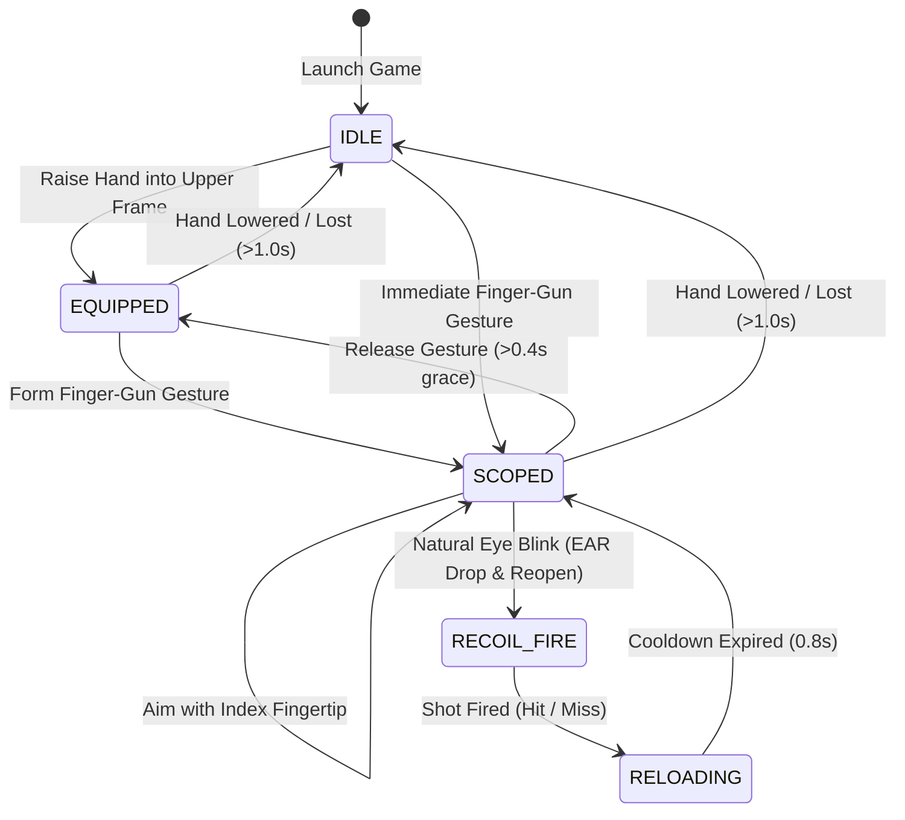

# 🎯 CV Sniper (Stage 4 - High-Performance Edition)

[](https://www.python.org/)
[](https://opencv.org/)
[](https://developers.google.com/mediapipe)
[](tests/test_cv_sniper.py)
[](LICENSE)

A real-time, gesture- and eye-controlled computer vision sniper simulation game built with **Python**, **OpenCV**, and **Google MediaPipe Tasks API**.

Aim with your index finger, acquire the sniper scope using a natural finger-gun gesture, and trigger precision shots using an eye blink. Profiled and optimized for low latency and high framerates on standard webcams.

---

## 📸 Visual Showcase & Gameplay

| 01. Eye & Target Tracking (IDLE) | 02. Scope Acquisition (SCOPED) |
|:---:|:---:|
|  |  |
| *Real-time facial mesh eye contour tracking, autonomous targets, and telemetry HUD.* | *Finger-gun gesture engages optic zoom, ambient dimming, and mil-dot crosshair.* |

| 03. Precision Target Tracking | 04. Blink-to-Fire & Recoil Kickback |
|:---:|:---:|
|  |  |
| *Smoothed crosshair tracking index fingertip aligned on floating target ring.* | *Blink trigger fires shot: radial muzzle flash, recoil reticle, hit marker, and reload timer.* |

---

## ⚡ Performance Optimization Highlights

The Stage 4 architecture has been refactored for low-latency, high-framerate gameplay:

| Component | Naive Implementation | Optimized Implementation | Improvement |
|---|---|---|---|
| **Scope Optic Rendering** | 39.66 ms / frame | **3.89 ms / frame** | **10.2x Faster** (saves ~36 ms/frame) |
| **HUD Overlay Blending** | 1.75 ms / frame | **0.22 ms / frame** | **7.9x Faster** |
| **Webcam Frame Latency** | Buffered frame queue lag | **`BUFFERSIZE = 1` + DirectShow** | **Real-time instant response** |
| **Frame Memory Allocations** | Full-frame copying (~20 MB/frame) | **In-place Sub-ROI memory & cached masks** | **Zero full-frame allocations** |
| **Target Simulation Math** | Scalar NumPy wrapping overhead | **Pure Python math (`math.hypot`, etc.)** | **Zero wrap/unwrap overhead** |
| **Inference Preprocessing** | New buffer per frame | **Contiguous preallocated RGB buffer** | **Eliminates memory thrashing** |

---

## 🎮 How to Play & Controls

### Motion & Biometric Controls



| Action | Biometric / Gesture Input | Gameplay Response |
|---|---|---|
| **Equip Rifle** | Raise hand into the upper camera frame (`wrist_y < 0.75` or `palm_y < 0.65`) | Status transitions to `EQUIPPED` |
| **Scope In** | Form a **Finger-Gun** (Index & Thumb extended, middle/ring/pinky curled) | Optic scope engages; surrounding environment darkens |
| **Aim Crosshair** | Move your index fingertip across the camera view | Crosshair smoothly tracks index fingertip with exponential smoothing |
| **Trigger Pull (Fire)** | **Blink** naturally (single eye or both eyes) | Muzzle flash radial burst, recoil reticle shift, hit/miss marker, and score sound/feedback |
| **Un-scope** | Lower hand or release finger-gun | Scope gracefully disengages after a `0.40s` gesture grace window |

### Keyboard Shortcuts

| Key | Action | Description |
|---|---|---|
| `Q` or `ESC` | **Quit** | Cleanly closes camera, MediaPipe tasks, and OpenCV windows |
| `R` | **Reset** | Clears score, shots, hits, accuracy, and respawns all dynamic targets |
| `S` | **Toggle Skeletons** | Shows or hides hand skeleton connections and eye contour overlays |
| `D` | **Toggle HUD** | Shows or hides the real-time telemetry HUD overlay |

---

## 🧠 Core Features & Subsystems

### 1. Vision Detection Engine (`cv_controller/detector.py`)
- Powered by **Google MediaPipe Tasks API** (`HandLandmarker` and `FaceLandmarker`) running in continuous `VIDEO` mode with monotonic timestamps.
- Zero-copy preallocated contiguous RGB buffer (`_rgb_buffer`) for inference.
- Automatic mirroring (`cv2.flip(frame, 1)`) for intuitive, natural aiming.

### 2. Gesture Recognition Geometry (`cv_controller/gestures.py`)
- **Finger-Gun Detection**: Calculates relative Euclidean distances between finger tips, PIP joints, and the wrist landmark. Detects when index and thumb are extended while middle, ring, and pinky remain curled.
- **Hand Elevation Check**: Normalized Y-coordinate tracking of wrist and palm centroid to distinguish deliberate weapon equipping from resting hands.

### 3. Eye Aspect Ratio (EAR) & Blink Trigger (`cv_controller/gestures.py`)
- Calculates Eye Aspect Ratio across 6 landmark points per eye:
  $$\text{EAR} = \frac{\|p_2 - p_6\| + \|p_3 - p_5\|}{2 \cdot \|p_1 - p_4\|}$$
- **Stateful `BlinkDetector`**:
  - Differentiates intentional trigger blinks from natural prolonged closures or accidental micro-twitches.
  - Enforces timing thresholds: `MIN_BLINK_DURATION = 0.05s`, `MAX_BLINK_DURATION = 0.50s`.
  - Fires shot upon eye re-opening with a strict `0.20s` blink debounce cooldown.

### 4. Dynamic Target Simulation & Physics (`cv_controller/game.py`)
- Autonomous floating targets with randomized radius (22–34 px), speed (75–150 px/s), and trajectories.
- Continuous boundary collision detection and elastic bounces to keep targets within the playable viewport.
- Precision hit registration with configurable tolerance radius (`HIT_TOLERANCE = 8 px`).
- Asynchronous target respawn scheduler with randomized delays (0.7s – 1.5s).

### 5. High-Performance Renderer (`cv_controller/renderer.py`)
- **Precomputed Scope Masks**: Pre-allocates circular masks at startup to eliminate per-frame mask creation.
- **Sub-ROI Darkening**: Darkens the exterior frame using SIMD-accelerated `cv2.convertScaleAbs` and restores the bright circular sight picture via ROI memory operations.
- **Optic Reticle**: Renders sniper crosshair lines, center pip, and 30-degree milliradian dial markers.
- **Recoil & Muzzle Flash**: Expanding radial flare animation localized to a bounding ROI, plus vertical reticle kickback.
- **Real-Time Telemetry HUD**: Sub-ROI blended glassmorphism panel displaying game state, hand/gesture presence, face tracking, live EAR, score, hit accuracy, reload timer, and FPS.

---

## 🏗️ Project Architecture

```
CV-Sniper/
├── main.py                     # Main game loop, camera orchestration, and event dispatch
├── requirements.txt            # Runtime dependencies (opencv-python, mediapipe, numpy)
├── LICENSE                     # MIT License
├── README.md                   # Project documentation
│
├── cv_controller/              # Modular Computer Vision Engine
│   ├── __init__.py             # Public package exports
│   ├── config.py               # Centralized configuration, thresholds, and color palette
│   ├── detector.py             # MediaPipe task lifecycle and landmark extraction
│   ├── gestures.py             # Finger-gun geometry, EAR calculation, and BlinkDetector
│   ├── game.py                 # State machine, target physics, collision math, and score
│   └── renderer.py             # OptimizedRenderer, sub-ROI optic scope, and HUD overlays
│
├── models/                     # MediaPipe task model assets
│   ├── hand_landmarker.task    # Hand landmark tracking model
│   └── face_landmarker.task    # Face landmark tracking model
│
├── tests/                      # Automated unit and integration test suite
│   └── test_cv_sniper.py       # 15 tests: physics, state machine, EAR, blink, and renderer
│
└── Working Screenshot 01-04.png# Gameplay showcase screenshots
```

---

## 🚀 Getting Started

### 1. Prerequisites
- **Python 3.10+** (Tested on Python 3.10, 3.11, 3.12, 3.13)
- A working **Webcam** (720p or 1080p recommended)

### 2. Installation

1. **Clone the repository:**
   ```bash
   git clone https://github.com/VANSHxGIT/CV-Sniper.git
   cd CV-Sniper
   ```

2. **Create and activate a virtual environment:**
   ```bash
   # Windows (PowerShell)
   python -m venv .venv
   .\.venv\Scripts\Activate.ps1

   # Linux / macOS
   python3 -m venv .venv
   source .venv/bin/activate
   ```

3. **Install dependencies:**
   ```bash
   pip install -r requirements.txt
   ```

4. **Verify model files:**
   Ensure `hand_landmarker.task` and `face_landmarker.task` are located in `models/`. If needed, download them directly:
   - [Hand Landmarker Task](https://storage.googleapis.com/mediapipe-models/hand_landmarker/hand_landmarker/float16/1/hand_landmarker.task)
   - [Face Landmarker Task](https://storage.googleapis.com/mediapipe-models/face_landmarker/face_landmarker/float16/1/face_landmarker.task)

### 3. Run the Game

```bash
python main.py
```

---

## 🧪 Automated Test Suite

CV Sniper includes an automated test suite with **15 unit and integration tests** verifying mathematical calculations, gesture recognition, blink state machines, target physics, clipping bounds, and inference:

```bash
python -m unittest discover -s tests -v
```

### Test Coverage Overview

- `TestGestures`:
  - `test_distance`: Euclidean distance between raw tuples and 3D landmark objects.
  - `test_finger_gun_detection`: Geometric finger-gun posture validation.
  - `test_hand_is_raised`: Vertical palm/wrist threshold calculation.
  - `test_eye_aspect_ratio`: 6-point EAR calculation with known geometry.
  - `test_blink_detector_lifecycle`: Full blink state lifecycle, debounce cooldown, and duration bounds.
- `TestGameEngine`:
  - `test_target_creation_and_bounds`: Boundary containment for spawned targets.
  - `test_target_physics_bounce`: Target velocity inversion on boundary collision.
  - `test_target_hit_detection`: Center hits, margin tolerance hits, and misses.
  - `test_stats_tracking`: Shots, hits, score calculation, and accuracy percentage.
  - `test_engine_state_transitions`: Complete `IDLE` ➔ `EQUIPPED` ➔ `SCOPED` state transitions with timeouts.
- `TestRenderer`:
  - `test_scope_clipping_corners`: Scope clipping stability at boundaries and off-screen coordinates.
  - `test_hud_rendering`: HUD overlay rendering and dimensions.
  - `test_shot_effect_rendering`: Muzzle flash burst rendering within bounds.
  - `test_pixel_point_clamping`: Clamping out-of-bounds normalized coordinates to viewport.
- `TestVisionDetector`:
  - `test_detector_inference`: Pipeline initialization and inference handling on black mock frames.

---

## ⚙️ Configuration & Customization

All parameters can be tuned in [`cv_controller/config.py`](cv_controller/config.py):

| Parameter | Default | Description |
|---|---|---|
| `FRAME_WIDTH`, `FRAME_HEIGHT` | `1280`, `720` | Camera capture and rendering resolution |
| `CAMERA_BUFFER_SIZE` | `1` | OpenCV frame buffer size (eliminates frame queue latency) |
| `SCOPE_RADIUS` | `155` | Optical scope radius in pixels |
| `SCOPE_DARKNESS_ALPHA` | `0.35` | Brightness multiplier for vignette outside the scope |
| `AIM_SMOOTHING` | `0.30` | Exponential moving average factor for crosshair smoothing |
| `FIRE_COOLDOWN` | `0.80` | Minimum delay in seconds between consecutive shots |
| `GESTURE_GRACE` | `0.40` | Grace period in seconds to hold scope if finger-gun is briefly lost |
| `HAND_LOST_TIMEOUT` | `1.0` | Timeout in seconds before returning to IDLE when hand leaves frame |
| `CLOSED_EAR`, `OPEN_EAR` | `0.20`, `0.235` | Eye Aspect Ratio thresholds for blink detection |
| `MIN_BLINK_DURATION` | `0.05` | Minimum seconds eyes must be closed for valid blink |
| `MAX_BLINK_DURATION` | `0.50` | Maximum seconds eyes can be closed before blink is rejected |
| `TARGET_COUNT` | `4` | Number of simultaneous floating targets |
| `TARGET_RADIUS` | `(22, 34)` | Min and max radius of dynamic targets |
| `TARGET_SPEED` | `(75.0, 150.0)` | Min and max velocity of targets in pixels/second |
| `TARGET_SCORE_VALUE` | `100` | Points awarded for hitting a target |
| `HIT_TOLERANCE` | `8` | Extra hit radius tolerance in pixels |

---

## 📜 License

This project is licensed under the [MIT License](LICENSE).
